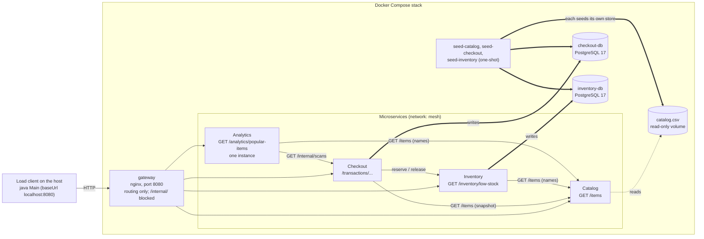
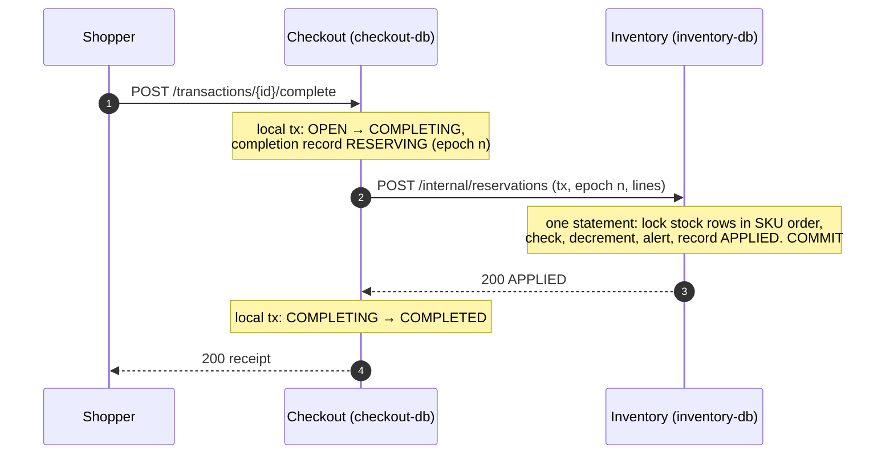

# Self-Checkout Backend — Microservices, a Private Store per Service

Week 7 of the architecture series. The frozen contract in [`spec.yaml`](./spec.yaml) is served
by **four independently deployable microservices**. Each one owns its data, and none can read
another's: when one needs something that belongs to another, it asks that service's API. The one
request that must change two services' data, completing a transaction, is coordinated as a
**saga** with compensation. An nginx **gateway** on `:8080` routes each request by path, so the
unmodified Java load client in `../load-client/` still sees one base URL.

## Microservices

| Service | Business function | Endpoints it owns | Its private store |
| --- | --- | --- | --- |
| **Catalog** | What can be sold, and at what price | `GET /items` | `catalog.csv`, a **read-only file** on a volume only Catalog (and its seed job) mounts |
| **Checkout** | Running a basket from start to payment | `POST /transactions`, `POST /transactions/{id}/items`, `POST /transactions/{id}/complete`, `GET /transactions/{id}` | **`checkout-db`**: PostgreSQL 17 with transactions, scans, and the record of each completion in flight |
| **Inventory** | How much is on hand, and what needs restocking | `GET /inventory/low-stock` | **`inventory-db`**: PostgreSQL 17 with stock, reservations and low-stock alerts |
| **Analytics** | Understanding buying behaviour | `GET /analytics/popular-items` | **None.** A rolling window held in memory and rebuilt from Checkout's scans |

Infrastructure, not services: the **gateway** (nginx, routing only), the **seed jobs** (one per
store, run once before a service starts) and **tools** (the cross-store verification, on demand).

Why the stores differ: Checkout's and Inventory's data changes under load and cannot be
recomputed, so each is a separately running database on a network only it can reach. Catalog's
data is a fixed list that never changes after seeding, so a file is enough. Analytics' data is
derived from Checkout's scans, which are already durable there, so it needs nothing of its own.

### Infrastructure



How to read it:
- **Thick arrows** are writes to a store, **dotted** is a read of the file, **thin arrows** are HTTP calls between services (the `mesh` network).
- Every store has **exactly one service** attached to it. `check_isolation.sh` proves, from inside the running containers, that no service can open another's database.
- **Startup order**: each database healthy → its seed job completes → its service starts → the gateway starts. Services never wait for each other; peers are contacted lazily, so any one can start while another is down. Analytics depends on nothing.
- **Ports**: the gateway is published on `:8080`. Each service is also on `127.0.0.1:8081`–`8084` (catalog, checkout, inventory, analytics) for debugging and the verification tool. The databases are on `127.0.0.1:5442` (checkout) and `:5443` (inventory).

Full unit, network, credential and port details:
[`contracts/compose-topology.md`](./specs/007-microservices-architecture/contracts/compose-topology.md).

## Who may call whom

| Caller | Callee | What for |
| --- | --- | --- |
| Checkout, Inventory, Analytics | Catalog | `GET /items`, cached in memory as a snapshot (prices for scans, names for reports) |
| Checkout | Inventory | `POST /internal/reservations`, `DELETE /internal/reservations/{tx}?epoch=n` (the saga) |
| Analytics | Checkout | `GET /internal/scans?after=n` (the scan log, by position) |
| verification tool | Checkout, Inventory, Analytics | `GET /internal/reports/*` (read-only) |

`/internal/*` is served on the services' own port and is **blocked at the gateway**. Contracts:
[`internal-apis.md`](./specs/007-microservices-architecture/contracts/internal-apis.md).

[`scripts/check_boundaries.py`](./scripts/check_boundaries.py) enforces this as part of the test
suite (eleven rules). It fails on:
- a service importing another service's code, or the removed shared data library;
- a database library in Catalog or Analytics, or in `checkout_web`;
- SQL naming a table that isn't in that service's own models;
- a raw HTTP client or socket in a service, or a call to a peer it may not call;
- compose giving a service another's database, credentials or volume, or attaching a second service to a store's network;
- the gateway proxying `/internal/`, or Analytics running more than one instance.

The only shared code is [`checkout_web`](./packages/checkout_web/): the contract's error shape,
request parsing, the app factory, `/healthz`, money formatting, request ids and the service
client. It knows no schema and imports no database library.

## Completing a transaction: a saga

Completion is the one request that changes two stores: Checkout (the transaction) and Inventory
(the stock). No transaction spans two databases, so Checkout **orchestrates** a short saga, and
every step is idempotent so any step can be repeated safely.



The hot SKU's stock lock is held only inside Inventory, for one statement plus `COMMIT`
(the spec 006 finding), and is released before Checkout finalizes.

| What goes wrong | What the saga does | The shopper sees |
| --- | --- | --- |
| Stock is short | Nothing to undo; the transaction reopens | `409 INSUFFICIENT_STOCK` |
| Inventory never answers (timeout, error, 5xx) | Retry the same reserve within a 4 s budget; then **release** and reopen | `503`, transaction still open, retry works |
| The reserve landed but its reply was lost | The retry is recognised: stock is reduced once | `200` |
| Checkout's own final step fails | **Release** the reservation, reopen | `503` |
| The release cannot be delivered either | Left `COMPENSATING`; the shopper's next `complete` finishes it and starts a fresh attempt, or the recovery loop does | `503`, then works |
| Checkout crashes mid-saga | The recovery loop (lease 10 s) rolls back an unconfirmed reserve, or finishes one that was recorded | after restart: `GET` shows `OPEN` or `COMPLETED` |
| A second `complete` while one is running | Refused | `409 TRANSACTION_NOT_OPEN` (as in 005) |
| Analytics is down | Nobody calls it during a scan or a completion | unaffected |

Each attempt has an **epoch**, and Inventory records one adjustment per `(transaction, epoch)`.
A release leaves a record even when there was nothing to undo, so a reserve of the same attempt
that arrives late is refused; a rolled-back transaction's next attempt is a new epoch and is not.
Every step logs one JSON line with the request id; trace one request across the services with
`./scripts/trace_request.sh <request-id>`.

Design: [`contracts/completion-saga.md`](./specs/007-microservices-architecture/contracts/completion-saga.md),
[research R1–R4](./specs/007-microservices-architecture/research.md).

## Analytics: an in-memory pipeline that pulls from Checkout

```text
TailIngest ─q1─▶ WindowFilter ─q2─▶ AggregationFilter ─q3─▶ RankingFilter ─slot─▶ OutputFilter
 (pull scans)    (slide by id)      (running counts)        (top-200)              (latest-wins, publish)
```

One pipeline runs for the life of the process, as in 005, but its source and its output changed.
- **TailIngest** polls Checkout's `GET /internal/scans?after=<id>` every 100 ms. It keeps a contiguous watermark, so scans that commit out of order are never skipped, and an id that never commits is skipped after 1 s.
- **Output** is published into memory. The window, counts and ranking live in memory and are never written anywhere.
- **Restart**: Analytics reads Checkout's highest scan id, computes the last 500-scan boundary and rebuilds the last 1 000 scans. Catching up after any downtime costs about 1 000 rows.
- **No leader election.** 005 needed a database lock so replicas would not fight over one snapshot row. With nothing shared to write, a second instance would only duplicate work, and compose runs exactly one.
- **Checkout is down**: Analytics keeps serving its last ranking and resumes when Checkout returns. **Analytics restarts while Checkout is down**: it answers with the empty window (not an error) until Checkout is back.
- **Checkout's data is reset**: Checkout names its scan log (`logId`); if it changes, Analytics starts over, even if the new log has reached the old position.

Design: [research R5](./specs/007-microservices-architecture/research.md) and
[data-model §4](./specs/007-microservices-architecture/data-model.md).

## What changed from Week 5

| | Week 5 (005) | Week 7 (007) |
| --- | --- | --- |
| Data | one PostgreSQL shared by all four | a private store per service; no service can reach another's |
| Shared code | `checkout-data`: schema, repositories, seeds (the deliberate coupling) | gone; only `checkout-web`, which knows no schema |
| Needing another's data | read the shared tables | call its API, keep a snapshot |
| Stock | Checkout's, in the shared database | Inventory's; Checkout reserves it |
| Completion | one database transaction | an orchestrated saga with compensation, retries and a recovery loop |
| Analytics | tails a table, publishes to a snapshot row, leader lock | pulls Checkout's scan log, in memory, no lock |
| Failure of one service | its routes fail | its routes fail, dependants fail cleanly or heal later |

## Prerequisites

- **Docker Desktop**, running, with ≥ 8 CPUs and ≥ 8 GB memory (Settings → Resources), and Compose v2 (`docker compose version`).
- **JDK 21+** for the load client.
- **`uv`** and a native PostgreSQL 17 (`brew install postgresql@17`), only for the host-side test suite.

## Run

```bash
docker compose up -d --build --wait     # build, seed each store, start everything; blocks until healthy
curl -s localhost:8080/items | head -c 120
docker compose ps                       # 2 databases, 3 seeds (exited), 4 services, gateway: healthy
docker compose down -v                  # tear down, including every store
```

One service at a time:

```bash
docker compose stop inventory           # completions answer 503 (and stay retryable); low-stock answers 503; the rest work
docker compose start inventory
docker compose up -d --build --no-deps --force-recreate analytics   # rebuild and redeploy just this one
```

Each seed job runs `--if-empty`, so it seeds only an empty store. A fresh run therefore always
starts with `docker compose down -v`.

## Test

```bash
uv sync
uv run pytest -q                        # all four services in-process, with fault injection between them
uv run python scripts/check_boundaries.py
./scripts/check_isolation.sh            # needs the stack up: no service can reach another's store
./scripts/check_independence.sh         # needs the stack up: recreate, then stop, each service in turn
./scripts/check_crash_recovery.sh       # needs the stack up: kill Checkout under load; the stores must agree
```

The suites in `tests/`:
- `contract/`: the frozen contract, unchanged from earlier weeks.
- `integration/`: the stores, Analytics' pull, request ids, timeouts, the verification tool.
- `failure/`: every outcome of the saga (a failure injected at each step, a crash at each point), idempotency, Analytics faults, and many baskets racing for the hot SKU. After each, the stores must agree.
- `unit/`: filters, window, client, catalog file, settings, routes, boundaries.

The in-process suite uses two native databases, `checkout_checkout_test` and
`checkout_inventory_test` (names must end in `_test` or it refuses to start), a temporary catalog
file, and an in-process stand-in for the network that can drop, delay or fail chosen calls.

The same contract tests over real HTTP, through the gateway and the containers:

```bash
docker compose -f compose.yaml -f compose.test.yaml up -d --build --wait
GATEWAY_URL=http://localhost:8080 uv run pytest -q tests/contract
docker compose -f compose.yaml -f compose.test.yaml down -v
```

## Measure

```bash
./scripts/run_load_tests.sh             # default run, then stress; fresh stack for each
./scripts/run_load_tests.sh stress      # or: default
docker compose --profile tools run --rm --build tools   # the graded correctness check, across all stores
python scripts/step_timings.py logs/compose-stress.log  # where a completion's time goes, by step
```

Each run does a fresh `down -v` and `up --wait`, then runs the load client with exactly the
assignment's flags (`./run.sh`, and `./run.sh --stations=100 --duration=120`). It moves the
report into `../load-client/reports/007-microservices-architecture/`, saves the compose logs to
`logs/`, verifies the invariant, and leaves the last stack up for inspection.

The check opens no database: each service describes its own data over `/internal/reports/*`,
and the tool verifies that `initial_stock − current_stock` equals the completed line items, per
SKU; no stock is negative; no transaction is stuck `COMPLETING`; every reservation matches a
completed transaction; and Analytics has read every scan.

### Graded reports (2026-10-23)

| Report | Config | tx/s | items/s | COMPLETE err % | Invariant |
| --- | --- | --- | --- | --- | --- |
| [`report-20261023-104702.json`](../load-client/reports/007-microservices-architecture/report-20261023-104702.json) | default (10 stations / 60 s) | 200.5 | 3 730 | 43.2 % | PASS |
| [`report-20261023-104920.json`](../load-client/reports/007-microservices-architecture/report-20261023-104920.json) | stress (100 stations / 120 s) | 196.2 | 5 448 | 62.1 % | PASS |

Every error is a contract-defined `409 INSUFFICIENT_STOCK` once hot SKUs sell out; there were
no `5xx` responses, timeouts or tracebacks.

**Against Week 5: 91 % (default) and 103 % (stress).** Against Week 6, whose hot-path code this
builds on, it is 76 % and 87 %: a completion is now three local transactions in Checkout around
one call to Inventory, instead of one transaction. The per-step timings, and a regression this
work found and fixed (a savepoint that held the hot-SKU locks across extra round trips), are in
[`../load-client/reports/README.md`](../load-client/reports/README.md#week-7--microservices-a-private-store-per-service-2026-10-23).
As in earlier weeks, results are not directly comparable to the native runs of Weeks 1–4: the
whole system runs inside Docker Desktop's VM.

## Inspect

Each database is reachable from the host on its published port (user and password are in
`.env.example`), or from inside its container:

```bash
psql -h 127.0.0.1 -p 5442 -U checkout_user checkout     # password: checkout_pass
psql -h 127.0.0.1 -p 5443 -U inventory_user inventory   # password: inventory_pass
docker compose exec inventory-db psql -U inventory_user -d inventory
```

Stock, in Inventory's database. `units_sold` should equal the `Units decremented` that the check
reports:

```sql
SELECT count(*)                                   AS skus,
       sum(initial_stock - current_stock)         AS units_sold,
       count(*) FILTER (WHERE current_stock = 0)  AS sold_out,
       count(*) FILTER (WHERE current_stock < 50) AS below_threshold
  FROM inventory_stock;
```

Reservations, one per `(transaction, epoch)`; `APPLIED` ones belong to completed transactions,
`RELEASED` ones are rolled-back attempts:

```sql
SELECT state, count(*) FROM stock_adjustment GROUP BY state;
```

Completions in Checkout's database; after a quiet moment nothing should be `RESERVING`,
`RESERVED` or `COMPENSATING`:

```sql
SELECT state, count(*) FROM completion GROUP BY state;
```

What Analytics is serving, and how far it has read:

```bash
curl -s 'localhost:8080/analytics/popular-items?limit=5'
curl -s localhost:8084/internal/reports/cursor        # {"lastScanId": ..., "windowEnd": ...}
docker compose logs analytics | grep -E 'pipeline|window published|gap skipped' | tail
```

## How it works

| Concern | Approach | Where |
| --- | --- | --- |
| Routing | nginx, by path: `= /items` → catalog, `/transactions` → checkout, `/inventory/` → inventory, `/analytics/` → analytics, `/internal/` → 404, everything else → checkout (same 404 body as before). Stamps `X-Request-ID` | `gateway/nginx.conf` |
| Catalog | A CSV loaded whole into memory; `GET /items` is a pre-rendered body in ascending SKU order. Other services keep a lazily loaded snapshot of it | `catalog_service/store.py`, each service's `catalog_client.py` |
| Scan | One CTE: bump the transaction's counters, insert the line (with the price from the snapshot), `RETURNING` both. Autocommit, so one round trip; no other service is called | `checkout_service/service.py` → `repo.py` |
| Completion | The saga above | `checkout_service/saga.py`, `recovery.py`; `inventory_service/reserve.py` |
| Never oversell | Inventory's conditional statement locks the stock rows in SKU order, checks, decrements and records the reservation at once; `CHECK (current_stock >= 0)` as a backstop | `inventory_service/reserve.py` |
| Low-stock report | Live stock joined to the latest alert per SKU; names from Catalog's snapshot | `inventory_service/low_stock.py` |
| Popular items | In-memory pipeline pulling Checkout's scan log | `analytics_service/pipeline.py`, `supervisor.py`, `popular_items.py` |
| Calls between services | One client: connect 0.5 s, read 2 s, idempotent calls retried within a budget, the request id forwarded | `checkout_web/client.py` |
| Money | Integer cents end to end | `checkout_web/money.py` |

## Layout

```
compose.yaml            checkout-db, inventory-db, 3 seed jobs, catalog, checkout, inventory,
                        analytics, gateway, tools; networks edge, mesh and one per database
compose.test.yaml       test-stack override (small catalog, separate project and images)
gateway/                nginx.conf + Dockerfile: routing only
packages/
  checkout_web/         SHARED, DATA-FREE: errors, request helpers and ids, app factory, /healthz,
                        money, the service client
services/
  catalog/              catalog_service    store (CSV), seed + requirements.lock + Dockerfile
  checkout/             checkout_service   service, saga, recovery, sweeper, repo, models, seed
  inventory/            inventory_service  reserve, low_stock, repo, models, seed
  analytics/            analytics_service  pipeline, supervisor, scan_source, scan_window, state
tools/                  verify_invariant.py + the checkout-tools Dockerfile
scripts/
  run_load_tests.sh     fresh stack → load → verify, for the default and stress runs
  check_boundaries.py   the eleven service-boundary rules
  check_isolation.sh    no service can reach another's store
  check_independence.sh recreate, then stop, each service; only its dependants may fail
  check_crash_recovery.sh   kill Checkout under load; the stores must agree
  trace_request.sh      one request id across every service's log
  step_timings.py       per-step timings from the logs
  lock_services.sh      regenerate the per-image requirements.lock files
  verify_invariant.py   host entry for tools/verify_invariant.py
tests/                  contract / integration / failure / unit; _dispatch.py is the gateway and the
                        network, in-process
```

## Design artifacts

- Week 7 (this architecture): [`specs/007-microservices-architecture/`](./specs/007-microservices-architecture/):
  - [spec](./specs/007-microservices-architecture/spec.md)
  - [plan](./specs/007-microservices-architecture/plan.md)
  - [research](./specs/007-microservices-architecture/research.md)
  - [data model](./specs/007-microservices-architecture/data-model.md)
  - [contracts](./specs/007-microservices-architecture/contracts/)
  - [quickstart](./specs/007-microservices-architecture/quickstart.md)
  - [tasks](./specs/007-microservices-architecture/tasks.md)
- Week 6 (hot-path latency): [`specs/006-service-perf-investigation/`](./specs/006-service-perf-investigation/)
- Week 5 (services over one shared database): [`specs/005-service-architecture/`](./specs/005-service-architecture/)
- Week 4 (streaming pipeline): [`specs/004-streaming-analytics/`](./specs/004-streaming-analytics/)
- Week 3 (pipelined analytics): [`specs/003-pipelined-analytics/`](./specs/003-pipelined-analytics/)
- Week 2 (layering): [`specs/002-layered-architecture/`](./specs/002-layered-architecture/)
- Week 1 (behaviour, schema, contract; still authoritative): [`specs/001-checkout-backend/`](./specs/001-checkout-backend/)
