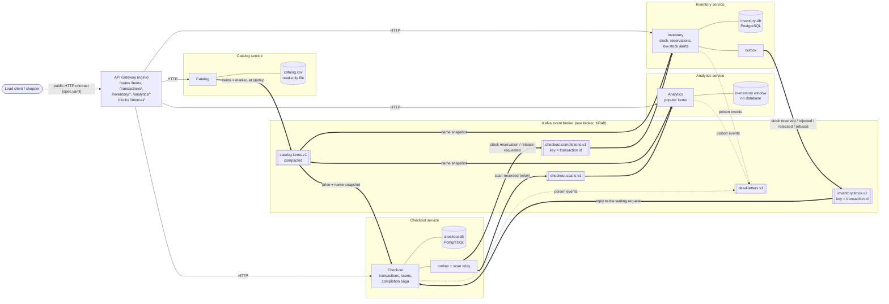
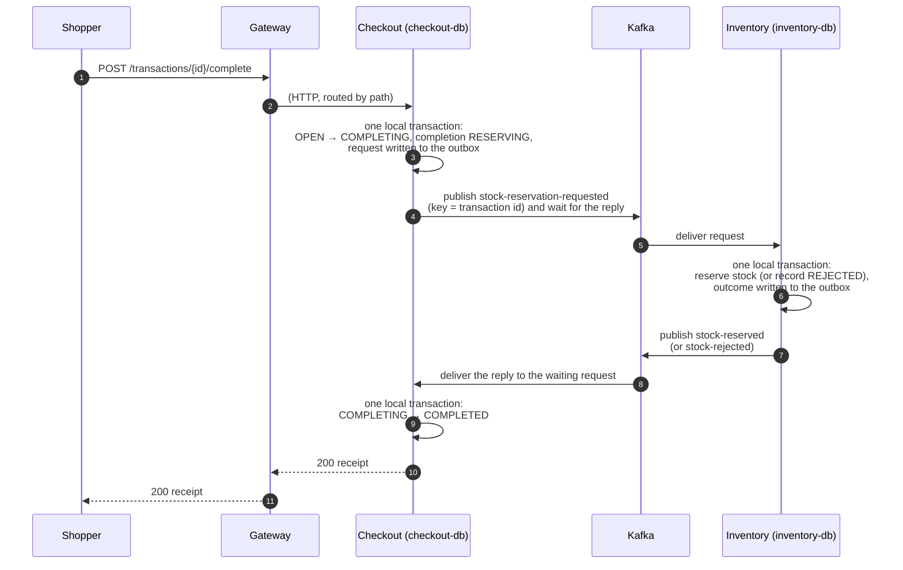

# Architecture: four microservices and a Kafka event broker

The self-checkout backend is four independently deployable microservices behind an API
gateway. Each owns a private data store. **They never call one another**: every
service-to-service interaction is an event on one Kafka broker. The only HTTP traffic is
shopper → gateway → the service that owns the route, which is the public contract and is
unchanged. (Spec: [`specs/008-event-driven-kafka`](../specs/008-event-driven-kafka/spec.md).)

*The same architecture as Mermaid, which GitHub renders in place (the SVG above is drawn by hand and kept in step with it):*

**Reading the diagram.** Thin arrows are HTTP; thick arrows are events. There is no arrow
between two services that does not pass through the broker, and the deployment enforces it: no
two services share a Docker network, so a service cannot even resolve a peer's name
(`scripts/check_isolation.sh`). Each service's only link to the broker is its own private
`bus_<service>` network.

## Topics

| Topic | Producer (only) | Consumers | Key | What it carries |
| --- | --- | --- | --- | --- |
| `catalog.items.v1` (compacted) | Catalog | Checkout, Inventory, Analytics | SKU | every item once at startup, then a marker with the count |
| `checkout.scans.v1` | Checkout (scan relay) | Analytics | none (log order) | one `scan-recorded` per scan, in scan-id order |
| `checkout.completions.v1` | Checkout (outbox) | Inventory | transaction id | `stock-reservation-requested`, `stock-release-requested` |
| `inventory.stock.v1` | Inventory (outbox) | Checkout (every worker) | transaction id | `stock-reserved`, `stock-rejected`, `stock-released`, `reservation-refused` |
| `dead-letters.v1` | any consumer | operators | source topic | an event that failed five times, with its error |

Event shapes: [`specs/008-event-driven-kafka/contracts/events.md`](../specs/008-event-driven-kafka/contracts/events.md).

## The four flows

| Flow | What happens |
| --- | --- |
| **Catalog snapshot** | Catalog publishes its fixed item list once at each start. Checkout, Inventory and Analytics read the topic from the beginning into an in-memory snapshot and are ready once they have seen the marker. A late or restarted service rebuilds from the topic; nobody calls Catalog. |
| **Scan → Analytics** | A scan is one committed row in Checkout's database. A relay publishes committed scans in order; Analytics consumes them, ignores any scan id it has already seen, and after a restart replays the topic's tail to rebuild its window. |
| **Completion** | Checkout commits "completing" and the reservation request in one transaction, publishes it, and waits (at most 3 s) for Inventory's reply event. Inventory takes the stock and writes its reply in one transaction, then publishes. Checkout finalizes, or compensates with a release request. |
| **Dead letters** | A consumer retries a failing event five times, then publishes it to `dead-letters.v1` and moves on. An outage of its database or the broker is waited out, not dead-lettered. |

## One completion, step by step

If no reply arrives, Checkout re-publishes the request twice (Inventory answers a repeat from
its recorded outcome, never applying stock twice), then compensates: it publishes
`stock-release-requested`, waits up to 1.5 s for `stock-released`, reopens the transaction and
answers `503`. A crash anywhere leaves a durable record (the completion row, the outbox row)
that the recovery loop and the outbox sweeper finish. Full table of outcomes:
[`completion-flow.md`](../specs/008-event-driven-kafka/contracts/completion-flow.md).

## Guarantees

| Guarantee | Mechanism |
| --- | --- |
| No service-to-service calls | no peer address in any service; no shared network; automated rules E1–E10 in `scripts/check_boundaries.py` |
| No event lost, none announced without its state change | transactional outbox (Checkout, Inventory); the scan table is Checkout's outbox for scans |
| At-least-once delivery is safe | every consumer is idempotent: by `(transaction, epoch)`, scan id or SKU |
| Order where it matters | one key → one partition: a reserve is always seen before its release |
| One service stopping does not stop the others | consumers read the topic when they return; snapshots rebuild from retained events |
