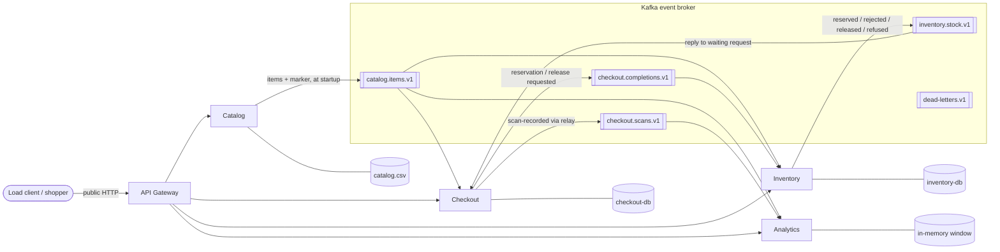

# Contract: Architecture Diagram (FR-023, SC-005)

Committed at `backend/docs/architecture.md` (Mermaid, renders on GitHub from the repo URL) with a
rendered `backend/docs/architecture.svg` beside it, linked from the README and from the load-report
folder's README.

## Must show

| Element | Detail |
| --- | --- |
| Shopper / load client | one arrow to the gateway, labelled "public HTTP contract" |
| API Gateway | routes `/items`, `/transactions*`, `/inventory/*`, `/analytics/*`; blocks `/internal/` |
| Four microservices | Catalog, Checkout, Inventory, Analytics |
| Private stores | `catalog.csv` (Catalog), `checkout-db` (Checkout), `inventory-db` (Inventory), "in-memory window" (Analytics) |
| Kafka broker | one box in the middle, outside every service |
| Topics | the five topics, drawn on or inside the broker |
| Direction of every producer and consumer | arrow from producer into the topic, arrow from the topic to each consumer |
| No service-to-service arrows | the only arrows between services pass through the broker |

## Starting sketch

The final diagram may add the outbox and relay inside Checkout and Inventory, and a second small
diagram for the completion sequence ([completion-flow.md](./completion-flow.md)).
